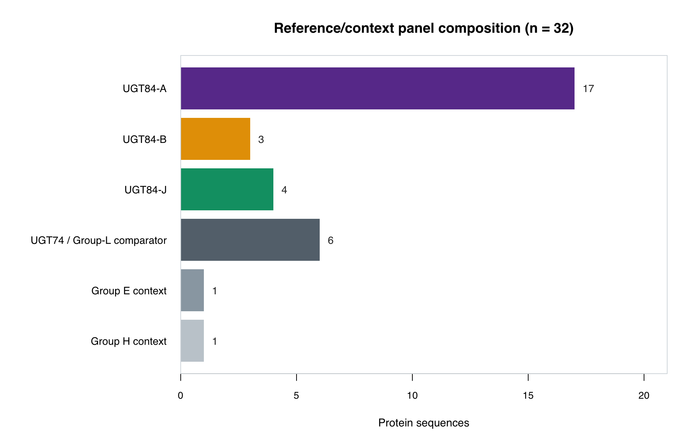
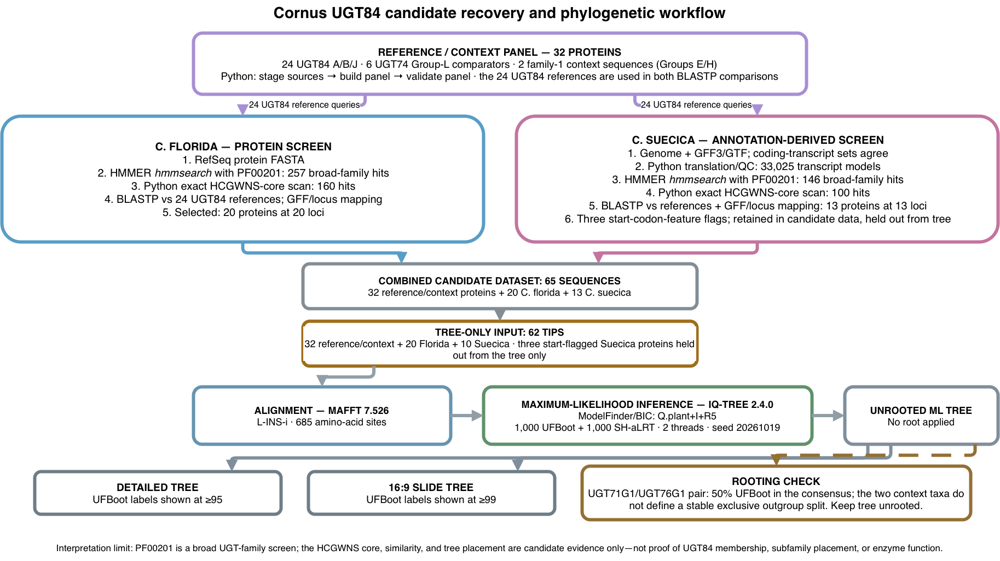
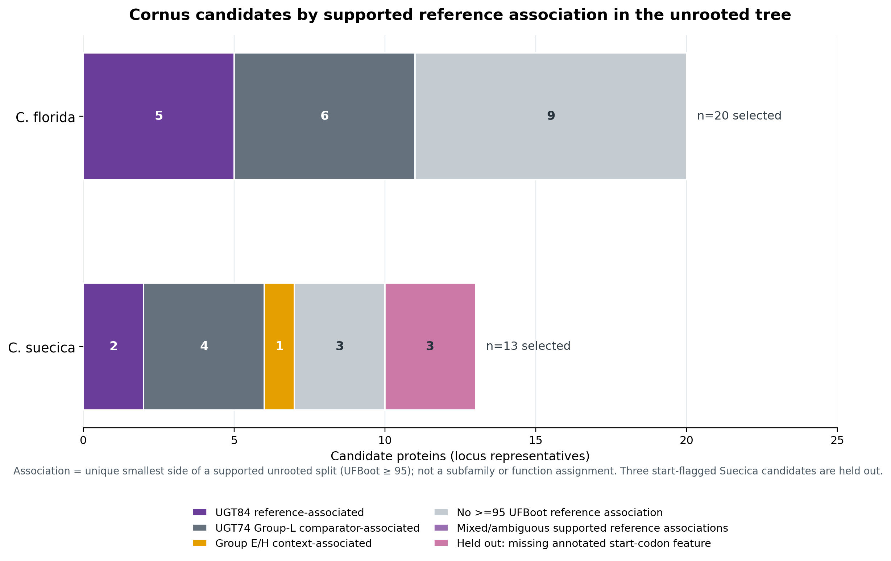

# Cornus UGT84 reference panel, candidate screening, and phylogeny

This repository documents a literature-supported UGT84 reference panel and its use in candidate recovery from two *Cornus* assemblies. Sequence similarity, conserved motifs, and tree placement are treated as candidate evidence—not as proof of UGT84 membership or biochemical function.

## Assemblies analyzed

| Species | Assembly accession | Data used in the analysis |
|---|---|---|
| *Cornus florida* | `GCF_030987335.1` | RefSeq protein set and assembly annotation for protein-to-locus mapping |
| *Cornus suecica* | `GCA_963922005.1` | Genome assembly and matched GFF3/GTF annotation for CDS translation and locus mapping |

The large Cornus genome FASTA, proteomes, GFF3, and GTF files are not included. Retrieve the required inputs by assembly accession before rerunning the full screen. The compact curated reference FASTAs are retained in the repository.

## Reference panel

The reference/context panel contains 32 amino-acid sequences: 24 named UGT84 A/B/J references, six UGT74 proteins used as Group-L comparators, and two additional family-1 context proteins. It distinguishes broad phylogenetic-group membership, UGT84 family/subfamily assignment, NCBI product labels, and experimental activity evidence.

The 24 UGT84 references comprise 17 UGT84A, three UGT84B, and four UGT84J sequences. Accessions, source headers, lengths, sequence-family evidence, and available activity evidence are listed in `Results/ugt84_reference_context_panel_manifest.tsv`. The combined reference/context FASTA is `Results/ugt84_reference_context_panel_32.faa`.

| Accession | Taxon | Gene label | UGT84 subfamily | Length (aa) |
|---|---|---|---|---:|
| AHA54051.1 | *Quercus robur* | UGT84A13 | A | 510 |
| ALO19890.1 | *Camellia sinensis* | CsUGT84A22 | A | 487 |
| ALO19891.1 | *Camellia sinensis* | CsUGT84J2 | J | 477 |
| ANN02875.1 | *Punica granatum* | UGT84A23 | A | 506 |
| ANN02877.1 | *Punica granatum* | UGT84A24 | A | 517 |
| BBB21213.1 | *Eucalyptus camaldulensis* | UGT84A25a | A | 499 |
| BBB21212.1 | *Eucalyptus camaldulensis* | UGT84A25b | A | 499 |
| BBB21215.1 | *Eucalyptus camaldulensis* | UGT84A26a | A | 511 |
| BBB21214.1 | *Eucalyptus camaldulensis* | UGT84A26b | A | 511 |
| BBB21216.1 | *Eucalyptus camaldulensis* | UGT84J3 | J | 497 |
| BBB21217.1 | *Eucalyptus camaldulensis* | UGT84J4 | J | 497 |
| BBB21218.1 | *Eucalyptus camaldulensis* | UGT84J5 | J | 469 |
| AEW31187.1 | *Vitis vinifera* | VvGT1 / UGT84A44 | A | 478 |
| AAU09443.1 | *Fragaria × ananassa* | FaGT2 / UGT84A6 | A | 555 |
| QZM06937.1 | *Canarium album* | UGT84A77 | A | 503 |
| XLV46658.1 | *Litsea cubeba* | LcUGT84B1 | B | 489 |
| BAA93039.1 | *Citrus unshiu* | CitLGT / UGT84A5 | A | 511 |
| AAF98390.1 | *Brassica napus* | UGT84A9 | A | 497 |
| CAJ77650.1 | *Brassica napus* | UGT84A10 | A | 472 |
| AII32448.1 | *Populus fremontii × P. angustifolia* | UGT84A17 | A | 502 |
| NP_193284.1 | *Arabidopsis thaliana* | UGT84A3 | A | 479 |
| AEE83611.1 | *Arabidopsis thaliana* | UGT84A4 | A | 475 |
| AAB87119.1 | *Arabidopsis thaliana* | UGT84B1 | B | 456 |
| AAB87106.1 | *Arabidopsis thaliana* | UGT84B2 | B | 438 |

Six UGT74 proteins provide neighboring Group-L comparison. They are not designated UGT84 proteins.

| Accession | Taxon | Gene label | Family / group | Length (aa) |
|---|---|---|---|---:|
| AEC10333.1 | *Arabidopsis thaliana* | UGT74F1 | UGT74 / L | 449 |
| AEC10331.1 | *Arabidopsis thaliana* | UGT74F2 | UGT74 / L | 449 |
| ALO19895.1 | *Camellia sinensis* | CsUGT74B4 | UGT74 / L | 459 |
| ALO19896.1 | *Camellia sinensis* | CsUGT74B5 | UGT74 / L | 471 |
| ALO19897.1 | *Camellia sinensis* | CsUGT74AF1 | UGT74 / L | 468 |
| ALO19898.1 | *Camellia sinensis* | CsUGT74AG1 | UGT74 / L | 455 |

Two family-1 proteins provide context: Medicago UGT71G1 (`AAW56092.1`; 465 aa), Group E, and Stevia UGT76G1 (`AAR06912.1`; 458 aa), Group H. The classification scheme in Hoffmann et al. (2023, Table 2) maps UGT71/72/88 to Group E, UGT74/75/84 to Group L, and UGT76 to Group H. The UGT74 comparators and UGT84 references therefore share a broad Group-L classification; this does not establish direct sister relationships. The panel includes only one Group-E and one Group-H sequence, with no UGT72 or UGT88 examples.

The grape accession AEW31187.1 is displayed as VvGT1 / UGT84A44, following Table 1 of the 2024 hydrolyzable-tannin review. The source FASTA header retains the earlier spelling `VvgGT1`. VvGT2 and VvGT3 are excluded because the review does not give them formal UGT84 names.



## Sequence sources and evidence records

The reference sequences were assembled from published studies and cited accession records. The evidence manifest records sequence-family membership separately from experimental activity. Some entries have direct β-glucogallin assay evidence, some were assayed without reported activity for a tested substrate panel, and others are included as family references without a functional claim. The 24-reference count must not be read as 24 experimentally demonstrated β-glucogallin enzymes.

Core literature sources include oak UGT84A13 (PMID 24412325), tea UGT84A22/UGT84J2 and Arabidopsis references (PMID 26941235), pomegranate UGT84A23/A24 (PMID 27227328), *Eucalyptus camaldulensis* UGT84A/J proteins (PMID 29775866), the tea UGT catalogue and group classification (PMID 37346124), tannin-pathway reconstitution (PMID 37526750), and the 2024 hydrolyzable-tannin review (PMID 40115765). Additional accession-linked identifiers include PMIDs 22090445, 26884604, 33719298, 34361803, and 40665580. Full citation details and locally retained source records are catalogued in [`references/ugt84_expanded/SOURCE_CATALOG.md`](references/ugt84_expanded/SOURCE_CATALOG.md).

The repository retains curated reference sequences, manifests, accession records, selected literature records, and extracted supplement text. The large Cornus genome/protein/annotation bundles are not included. The exact PF00201 profile build/source match and profile redistribution terms remain to be verified.

## Methods and reproducibility

### Pipeline overview



[Open the editable draw.io source](figures/cornus_ugt84_pipeline.drawio).

### Reference-panel construction

`Scripts/00_stage_reference_sources.py` stages the formal UGT84 sequences and manifest, six UGT74 comparator sequences, and two family-1 context sequences, recording file sizes and SHA-256 hashes. `Scripts/01_build_reference_panel.py` assembles the 32-sequence FASTA and sequence manifest. `Scripts/02_validate_reference_panel.py` checks source hashes, sequence/metadata correspondence, group counts, lengths, and exclusion of VvGT2/VvGT3.

### Cornus screening and mapping

For *C. florida*, `Scripts/stage_cornus_florida_inputs.py` stages the RefSeq protein FASTA, GFF3, sequence report, and PF00201.25 profile and records SHA-256 values. `Scripts/03_run_pf00201_hmmsearch.py` runs HMMER with `--cut_ga --cpu 2 --noali`; the screen recovered 257 protein hits (259 domain rows). `Scripts/check_pspg_core.py` found an exact HCGWNS core in 160 of those hits. This is a short-core scan, not a complete PSPG-box validation or UGT84 classifier.

`Scripts/05_run_ugt84_reference_blastp.py` compares screened proteins with the 24 formal UGT84 A/B/J references. `Scripts/06_select_blast_candidates.py` applies E-value ≤1e-5 and query coverage ≥70%, selecting either top-10 ranking per reference or identity ≥50%. It selected 20 Florida proteins, mapped to 20 distinct loci by the GFF-mapping and locus-representative steps.

For *C. suecica*, `Scripts/extract_cornus_suecica_proteins.py` reconstructs protein translations from GFF3 CDS features on the genome assembly. `Scripts/stage_cornus_suecica_inputs.py` stages annotation and sequence-report inputs. The GFF3 and GTF protein-coding transcript ID sets match (33,025); exon/UTR coordinates and CDS coverage agree, and no internal CDS phase mismatches were found. The translation manifest retains incompleteness flags rather than silently filtering models. HMMER recovered 146 broad PF00201 protein hits; 100 have the exact HCGWNS core. BLASTP selection recovered 13 proteins mapped to 13 loci.

The Suecica GFF3/GTF cover 11 chromosome IDs from the 91 assembly-report records; 80 records lack annotation in these files. Three selected Suecica models lack an annotated start-codon feature and do not begin with methionine. They remain in candidate data but were excluded from the tree input only. The local GenBank flatfile did not provide an independent CDS translation set.

### Combined input, alignment, and inference

`Scripts/12_build_combined_cornus_input.py` combines 32 references/context proteins with 20 Florida and 13 Suecica candidates (65 sequences). `Scripts/13_build_tree_input_62.py` holds out the three start-codon-flagged Suecica proteins for the tree only, producing a 62-tip input. `Scripts/10_run_mafft.py` runs MAFFT L-INS-i; `Scripts/11_run_iqtree.py` runs IQ-TREE. `Scripts/14_root_compare_tree.py` evaluates the proposed context sequences for rooting, and `Scripts/15_plot_tree_62.py` / `Scripts/16_plot_tree_62_supported.py` generate tree figures.

The final alignment has 685 amino-acid sites (487 parsimony-informative and 128 constant). ModelFinder selected `Q.plant+I+R5` by BIC. IQ-TREE used 1,000 UFBoot and 1,000 SH-aLRT replicates, BNNI, two threads, and seed `20261019`; 940 UFBoot trees were refined. The unrooted Newick support labels are SH-aLRT/UFBoot. No root was applied: the two context proteins do not define a stable exclusive outgroup split.

The repo includes the compact ML tree, bootstrap consensus, tip-label map, and Suecica exclusion table in `Results/tree_62/`. The raw alignment and Cornus sequence/annotation inputs are not included. The complete-screening scripts therefore require the assembly data listed above to be obtained separately.

### Reproduce the placement summary

From the repository root, the included Newick tree and tip metadata can be used to regenerate the per-protein placement TSV, count table, and figure:

```bash
python3 scripts/make_candidate_tree_placement_figure.py \
  --summary-out Results/cornus_candidate_tree_placements_reproduction.tsv \
  --counts-out Results/cornus_candidate_tree_placement_counts_reproduction.tsv \
  --plot-out figures/cornus_candidate_placement_counts_reproduction.png
```

The script refuses to overwrite existing outputs. Its association rule is documented in the output table and in the final section below.

### Tool versions used

- HMMER `3.4` (`hmmsearch`)
- NCBI BLAST+ `2.16.0+` (`blastp`)
- MAFFT `7.526` (L-INS-i)
- IQ-TREE `2.4.0`
- Python `3.11.13`
- Matplotlib `3.10.6`

## Screening, annotation quality, and tree results

### Candidate-screen summary

| Species | Assembly accession | Annotated proteins screened | PF00201 protein hits | Exact HCGWNS core | BLASTP-selected proteins | Unique loci | Tree tips |
|---|---|---|---:|---:|---:|---:|---:|
| *C. florida* | `GCF_030987335.1` | RefSeq protein set | 257 | 160/257 | 20 | 20 | 20 |
| *C. suecica* | `GCA_963922005.1` | 33,025 translated annotated transcripts | 146 | 100/146 | 13 | 13 | 10 |

The HCGWNS column is an exact short-core check, **not** a complete PSPG-box validation or a UGT84 classifier. The three Suecica candidates held out from the tree are `ENSLUWP00000000305`, `ENSLUWP00000007988`, and `ENSLUWP00000017449`; they remain in candidate data.

The reproduced BLASTP rule used E-value ≤1e-5 and query coverage ≥70%, selecting either top-10 ranking per reference or identity ≥50%. Most frequent best-reference queries among selected proteins were:

| Best BLASTP reference query | *C. florida* selected proteins | *C. suecica* selected proteins |
|---|---:|---:|
| ALO19890.1 (UGT84A22) | 7 | 5 |
| ALO19891.1 (UGT84J2) | 6 | 5 |
| AAB87106.1 (UGT84B2) | 2 | 0 |
| AEE83611.1 (UGT84A4) | 1 | 1 |
| BAA93039.1 (UGT84A5) | 1 | 1 |
| AAU09443.1 (FaGT2 / UGT84A6) | 0 | 1 |
| CAJ77650.1 (UGT84A10) | 1 | 0 |
| AAB87119.1 (UGT84B1) | 1 | 0 |
| XLV46658.1 (LcUGT84B1) | 1 | 0 |

These are best-BLAST-reference counts only; they do not assign UGT84 membership, subfamily, or function.

### Suecica protein and annotation quality

| Check | Result | Interpretation |
|---|---:|---|
| Genome FASTA / sequence-report records | 91 / 91 | Record lengths agree |
| Records with GFF3/GTF annotation | 11 | 80 assembly records lack annotation in these files |
| Protein-coding transcript models | 33,025 in both GFF3 and GTF | Transcript ID sets match |
| Exon and UTR coordinates | Exact match | GFF3/GTF cross-check passed |
| CDS coverage | Exact after separate start/stop features | Feature structures agree |
| Internal CDS phase mismatches | 0 | Phase-continuity checks passed |
| Models without completeness flags | 22,801 | Pass recorded model-completeness checks |
| Models with ≥1 completeness flag | 10,224 | Flags retained; counts can overlap |
| Missing start / stop-codon feature | 5,250 / 5,133 | Counts overlap |
| Terminal partial codons / ambiguous codons | 7 / 5 | Recorded by translation QC |

The three held-out candidates have the `start_codon_feature_missing` flag and do not begin with methionine. The annotation-derived screen covers only the 11 annotated chromosome IDs; it is not a protein search of the 80 unannotated assembly records.

### Tree inference results

The tree uses 62 tips and 685 aligned amino-acid sites. The best BIC model was `Q.plant+I+R5`; the ML log-likelihood was -30429.4627. The UGT71G1/UGT76G1 pair has 50% UFBoot in the consensus, and the ML topology places Suecica candidate `ENSLUWP00000008228` with UGT76G1 at SH-aLRT/UFBoot 7.7/39, with UGT71G1 sister to that pair. The three-tip context cluster is separated from the remainder at 99.9/99. No root, evolutionary direction, or ancestral state is inferred.

The six UGT74 tips are labeled “Group L UGT74 comparator”; Cornus candidates are not assigned UGT84 subfamilies. The compact ML tree, bootstrap consensus, detailed tip-label map, and Suecica exclusion table are bundled under `Results/tree_62/`; high-resolution detailed and slide tree figures are not included here.

## Tree placement relative to references



| Species | UGT84-reference-associated | UGT74 Group-L comparator-associated | Group E/H context-associated | Mixed/ambiguous | No ≥95 UFBoot reference association | Held out |
|---|---:|---:|---:|---:|---:|---:|
| *C. florida* | 5 | 6 | 0 | 0 | 9 | 0 |
| *C. suecica* | 2 | 4 | 1 | 0 | 3 | 3 |
| **Total** | **7** | **10** | **1** | **0** | **12** | **3** |

These categories describe topology in the unrooted ML tree; they are not UGT84 subfamily or enzyme-function assignments. For each Cornus tip, the summary uses the smallest side of a supported unrooted split (UFBoot ≥95) containing that candidate and reference/context tips. A unique reference category is reported; mixed categories are marked mixed/ambiguous; candidates without such a supported split are counted separately. The three flagged Suecica models are held out and have no tree placement.

The single Group E/H-context-associated Suecica candidate belongs to a supported three-tip context cluster, but its pairwise grouping with UGT76G1 alone has only 39% UFBoot.
The two context sequences therefore do not supply a stable exclusive outgroup split. The tree is unrooted; no evolutionary direction or ancestral state is inferred. PF00201, conserved-core presence, similarity, and tree placement remain candidate evidence only.


### PSPG-box boundary mapping and comparative profile analysis

The PSPG analysis uses the same 62-sequence MAFFT alignment as the tree; it does not realign the sequences. The conventional 44-residue box was extracted with `Biostrings` and `IRanges` from alignment columns 450–493 (inclusive). The boundary was checked against UGT84A13 (`AHA54051.1`): the extracted sequence is `WSPQEQVLAHPSVACFVTHCGWNSTMESLTSGMPVVAFPQWGDQ`, with S, E, C, Q, and Q at PSPG positions 2, 5, 15, 40, and 44. These residues match the UGT84 landmarks described in Figure 2a of Li et al. (2024), [*Communications Chemistry*](https://doi.org/10.1038/s42004-024-01231-1). The aligned `H[CS]G[WF]NS` core begins at column 468, corresponding to PSPG positions 19–24; exact `HCGWNS` occurs in 56/62 sequences, while six carry aligned variants. The core is a cross-check, not the sole basis for defining the box. The earlier 453–496 extraction was offset three residues downstream and is superseded; links below point to the corrected outputs. The corrected interval is gap-free in all 62 sequences.

`ggmsa` was used for the full-alignment overview and labeled PSPG-box detail. Per-position residue frequencies were compared across 24 UGT84 references, six UGT74 Group-L comparators, two family-1 context proteins, 20 *C. florida* candidates, and 10 *C. suecica* candidates. A position was called **provisionally UGT84-enriched in this sampled panel** when the UGT84 major residue occurred in at least 80% of references and in no more than two of the six UGT74 comparators. This exploratory filter was checked by leave-one-UGT84-reference-out analysis; it is not a validated family classifier.

| PSPG position | Alignment column | UGT84 major residue | UGT84 references | Same residue among Group-L UGT74 comparators |
|---:|---:|:---:|---:|---:|
| 5 | 454 | E | 20/24 (83%) | 0/6 (0%) |
| 11 | 460 | P | 22/24 (92%) | 0/6 (0%) |
| 14 | 463 | A | 20/24 (83%) | 1/6 (17%) |
| 31 | 480 | S | 20/24 (83%) | 0/6 (0%) |

Across these four positions, Cornus candidates matched 0–75% of the UGT84 major-residue profile (mean 32.5% for *C. florida*, 25% for *C. suecica*). In the leave-one-out check, 23 of 24 held-out UGT84 references scored higher against the training UGT84 profile than against the UGT74 profile. These are short-profile comparisons and do not assign UGT84 membership, subfamily, or enzyme activity to any candidate.

Figure 2a of Li et al. compares selected UGT72 and UGT84 sequences, whereas this analysis compares a different and broader set of groups. Its residue frequencies are therefore not expected to reproduce that figure. In particular, the UGT74 controls here are Group-L comparators, not UGT72 proteins; the detected differences are panel-enriched patterns, not a general UGT84-specific signature.


The six-residue core is HCGWNS at PSPG positions 19–24 (alignment columns 468–473). It is exact in 56/62 sequences (90.3%). 
The six variants involve only two substitutions:                                                                                                                                 
                                                                                                                                                         
 C→S at PSPG position 20: 3 sequences                                                                                                                  
 W→F at PSPG position 22: 4 sequences                                                                                                                  
 One sequence has both substitutions
 
|Group | Exact HCGWNS | Variants
|---:|---:|:---:|---:|---:|
GT84 references (n=24) | 24/24 | None |
GT74 Group-L comparators (n=6) | 4/6 | ALO19897.1 (HCGFNS); ALO19895.1 (HSGWNS) |
Group E/H (n=2) | 1/2 | AAR06912.1 / UGT76G1 (HSGWNS) |
C. florida candidates (n=20) | 19/20 | XP_059626305.1 (HSGFNS) |
C. suecica candidates (n=10) | 8/10 | ENSLUWP00000021829 and ENSLUWP00000024519 (HCGFNS) |

So, C→S occurs in UGT74, Group E/H , and one *C. florida* candidate; W→F occurs in UGT74, *C. florida*, and two Suecica candidates. 

